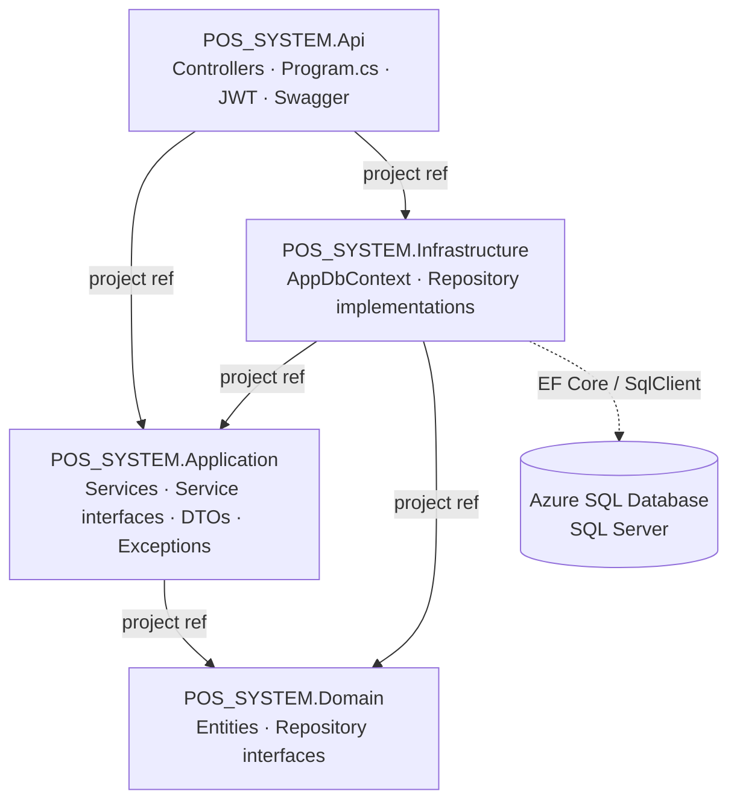
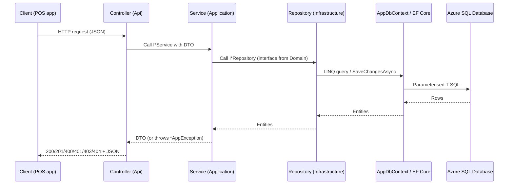
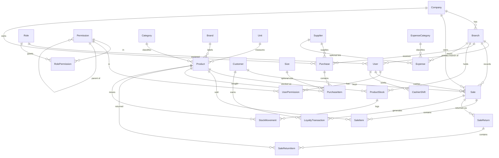
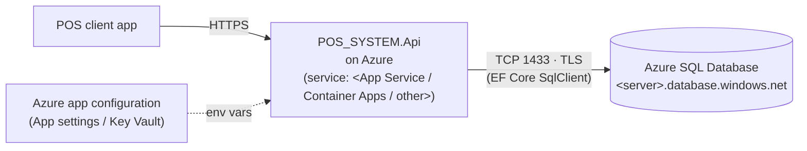

# POS_SYSTEM

A multi-company, multi-branch **Point-of-Sale backend** built with **.NET 10**, **ASP.NET Core Web API**, **Entity Framework Core** and **Microsoft SQL Server**, structured using **Clean Architecture** and the **Repository Pattern**. The production database runs on **Azure SQL Database**.


---

## Table of Contents

1. [Project Overview](#1-project-overview)
2. [Features](#2-features)
3. [Technology Stack](#3-technology-stack)
4. [System Architecture](#4-system-architecture)
5. [Project Structure](#5-project-structure)
6. [Database Architecture](#6-database-architecture)
7. [Azure Cloud Deployment](#7-azure-cloud-deployment)
8. [Prerequisites](#8-prerequisites)
9. [Installation and Local Setup](#9-installation-and-local-setup)
10. [API Documentation](#10-api-documentation)
11. [Authentication and Authorization](#11-authentication-and-authorization)
12. [Production Deployment](#12-production-deployment)
13. [Environment Configuration](#13-environment-configuration)
14. [Error Handling and Logging](#14-error-handling-and-logging)
15. [Development Guidelines](#15-development-guidelines)
16. [Known Limitations](#16-known-limitations)

---

## 1. Project Overview

`POS_SYSTEM` is the REST API behind a retail point-of-sale application. It lets a business that operates one or more **companies**, each with one or more **branches**, manage the full retail cycle:

- sell products at the till (completed, **held/parked** and **draft** sales),
- take returns against an existing invoice,
- buy stock from suppliers,
- track per-branch stock levels and every stock movement,
- reward customers with loyalty points,
- record expenses and close cashier shifts,
- administer users, roles and fine-grained permissions.

The solution is split into four projects that follow Clean Architecture: a dependency-free **Domain**, an **Application** layer holding business logic and DTOs, an **Infrastructure** layer holding EF Core and repository implementations, and an **Api** layer exposing HTTP endpoints.

> The API surface was ported from an earlier FastAPI implementation (visible in code comments). The JSON contract (property names such as `CategoryID`, the `detail` error key, snake_case route parameters) was deliberately kept compatible with the existing client — see [JSON conventions](#json-conventions).

---

## 2. Features

Every feature below was verified against the controller, service and repository code.

| Area | Implemented capability |
|------|------------------------|
| **Authentication** | Login with company + username/email + password; BCrypt password verification; JWT bearer token issuance; company lookup and credential pre-verification for a multi-company login flow. |
| **Users, roles & permissions** | CRUD for users and roles; hierarchical permission tree (modules → permissions); permissions assigned to roles and directly to users; permission keys returned at login; a role cannot be deleted while users are assigned to it. |
| **Companies & branches** | Company CRUD with logo upload; branch CRUD with auto-generated branch codes (`BR-001`). |
| **Catalogue** | Products (auto codes `P001`, barcode lookup, image upload, bulk and single price updates), categories, brands, units of measure. |
| **Customers** | CRUD with auto-generated codes (`CUS-0001`), customer groups, credit limit / opening balance / due amount. |
| **Suppliers** | CRUD with auto-generated codes (`SUP-0001`). |
| **Sales (POS)** | Create sales with line items; invoice numbers `INV-yyyyMMddNNNN`; **hold/park** sales (`Status = "Held"`); **draft** sales (`DRAFT-yyMMdd-NNNN`); filter sale history by date, customer, cashier and payment status; sale detail; delete. |
| **Sale returns** | Look up an invoice for its returnable items; create a return; `"Sales Return"` returns restock inventory and write a stock movement. |
| **Purchasing** | Purchase orders with items, batch number and size; numbers `PUR-yyMMNNNN`; stock is increased per branch and a stock movement is recorded. |
| **Inventory** | Per-branch stock (`ProductStock`) with reserved/reorder/maximum levels; stock listing, detail and update; stock movements recorded for sales, purchases and returns. |
| **Loyalty** | Points are **earned** on completed sales (10 points per 1,000 of net paid, rounded down), can be **redeemed** on a sale (1 point = 1 currency unit of discount), and can be manually adjusted; balances and history endpoints. |
| **Expenses** | Expense create/list/delete endpoints, categories, summary and by-category breakdown; numbers `EXP-yyyyMMddNNNN`. |
| **Cashier shifts** | Compute a shift summary (sales, returns, cash sales, cash refunds) for a user/branch/time window and close the shift with expected-vs-actual cash difference. |
| **File uploads** | Product images (JPG/PNG/WEBP only) and company logos, served from `/uploads`. |
| **API docs** | OpenAPI document and Swagger UI (Development environment only). |

---

## 3. Technology Stack

| Category | Technology | Version (from `.csproj`) |
|----------|------------|--------------------------|
| Language | C# | Default for .NET 10 |
| Runtime / Framework | .NET / ASP.NET Core Web API (controllers) | `net10.0` |
| ORM | Entity Framework Core (`SqlServer`, `Design`, `Tools`) | 10.0.11 |
| Database | Microsoft SQL Server (Azure SQL Database in production) | — |
| Cloud | Microsoft Azure | — |
| Authentication | `Microsoft.AspNetCore.Authentication.JwtBearer` | 10.0.12 |
| JWT creation | `System.IdentityModel.Tokens.Jwt`, `Microsoft.IdentityModel.Tokens` | 8.22.0 |
| Password hashing | `BCrypt.Net-Next` | 4.2.0 |
| API documentation | `Swashbuckle.AspNetCore` (Swagger UI) + `Microsoft.AspNetCore.OpenApi` | 10.2.3 / 10.0.11 |
| Solution format | `.slnx` | — |

---

## 4. System Architecture

### 4.1 Layers and dependency rule

Source-code dependencies point **inwards**. `POS_SYSTEM.Domain` references nothing; every other project depends on it directly or indirectly.



| Project | References | Responsibility |
|---------|-----------|----------------|
| `POS_SYSTEM.Domain` | — | Entities (`Sale`, `Product`, …) and **repository interfaces** (`ISaleRepository`, …). |
| `POS_SYSTEM.Application` | Domain | Business rules in `*Service` classes, service interfaces (`ISaleService`, …), request/response DTOs (C# `record`s), application exceptions. |
| `POS_SYSTEM.Infrastructure` | Application, Domain | `AppDbContext`, EF Core mappings, repository implementations that query SQL Server. |
| `POS_SYSTEM.Api` | Application, Infrastructure | HTTP surface: controllers, DI composition root (`Program.cs`), JWT setup, static file hosting, Swagger/OpenAPI. |

### 4.2 Request flow



Dependency injection is configured in `POS_SYSTEM.Api/Program.cs`: each `I*Repository`→`*Repository` and `I*Service`→`*Service` pair is registered with `AddScoped`, and `AppDbContext` is registered with `AddDbContext` using `UseSqlServer`.

**Middleware order** (`Program.cs`): OpenAPI + Swagger (Development only) → `UseHttpsRedirection` → `UseStaticFiles` (`/uploads`) → `UseAuthentication` → `UseAuthorization` → `MapControllers`.

---

## 5. Project Structure

`bin/` and `obj/` are omitted.

```text
POS_SYSTEM/
├── POS_SYSTEM.slnx                         # Solution file (4 projects)
├── README.md
│
├── POS_SYSTEM.Api/                         # Presentation layer (ASP.NET Core Web API)
│   ├── Program.cs                          # DI registrations, JWT, EF Core, middleware pipeline
│   ├── appsettings.json                    # Base configuration (connection string key, Jwt, Logging)
│   ├── appsettings.Development.json        # Development logging overrides
│   ├── Controllers/                        # 20 controllers, one per feature area
│   │   ├── AuthController.cs
│   │   ├── BranchesController.cs · BrandsController.cs · CategoriesController.cs
│   │   ├── CashierShiftsController.cs · CompaniesController.cs · CustomersController.cs
│   │   ├── ExpensesController.cs · LoyaltyController.cs · PermissionsController.cs
│   │   ├── ProductsController.cs · PurchasesController.cs · RolesController.cs
│   │   ├── SaleReturnsController.cs · SalesController.cs · StockController.cs
│   │   ├── SuppliersController.cs · UnitsController.cs · UsersController.cs
│   │   └── WeatherForecastController.cs    # Default project-template sample
│   └── Serialization/
│       └── PascalCaseIdNamingPolicy.cs     # Custom JSON naming policy (…Id → …ID)
│
├── POS_SYSTEM.Application/                 # Application / business layer
│   ├── Interfaces/                         # I*Service contracts (19)
│   ├── Services/                           # *Service implementations – business rules
│   ├── DTOs/                               # Request/response records, grouped per feature
│   └── Exceptions/
│       └── AuthExceptions.cs               # Unauthorized/Forbidden/NotFound/BadRequest AppException
│
├── POS_SYSTEM.Domain/                      # Enterprise core – no dependencies
│   ├── Entities/                           # 28 entity classes mapped to SQL tables
│   └── Interfaces/                         # I*Repository contracts (19)
│
└── POS_SYSTEM.Infrastructure/              # Data-access layer
    ├── Persistence/
    │   ├── AppDbContext.cs                 # DbSets + Fluent API mapping (OnModelCreating)
    │   └── Configurations/                 # IEntityTypeConfiguration<T> classes (see Known Limitations)
    └── Repositories/                       # *Repository implementations (19)
```

---

## 6. Database Architecture

### 6.1 Technology

- **Engine:** Microsoft SQL Server — **Azure SQL Database** in production.
- **ORM:** Entity Framework Core 10 with the `Microsoft.EntityFrameworkCore.SqlServer` provider.
- **Context:** `POS_SYSTEM.Infrastructure.Persistence.AppDbContext`, registered with `AddDbContext<AppDbContext>(o => o.UseSqlServer(GetConnectionString("DefaultConnection")))`.
- **Mapping:** Fluent API inside `AppDbContext.OnModelCreating` (scaffold-style: explicit table/column names, constraint names, `decimal` precision, `GETDATE()` / `SYSUTCDATETIME()` defaults, and unique indexes).

### 6.2 Entity relationships



### 6.3 Tables

| Table | Entity | Purpose |
|-------|--------|---------|
| `Companies`, `Branches` | `Company`, `Branch` | Tenant hierarchy: company → branches. |
| `Users`, `Roles`, `Permissions`, `RolePermissions`, `UserPermissions` | `User`, `Role`, `Permission`, `RolePermission`, `UserPermission` | Identity and RBAC. `Permissions` is self-referencing (`ParentPermissionId`) and has a unique `PermissionKey`. |
| `Products`, `Categories`, `Brands`, `Units`, `Sizes` | `Product`, `Category`, `Brand`, `Unit`, `Size` | Product catalogue and lookups. |
| `ProductStock`, `StockMovements` | `ProductStock`, `StockMovement` | Per-branch stock (unique on `ProductId + BranchId`) and an audit trail of every stock change. |
| `Sales`, `SaleItems` | `Sale`, `SaleItem` | Sales header/lines; unique `InvoiceNo`; `Status` is `Completed`, `Held` or `Draft`. |
| `SaleReturns`, `SaleReturnItems` | `SaleReturn`, `SaleReturnItem` | Returns against an original sale. |
| `Purchases`, `PurchaseItems` | `Purchase`, `PurchaseItem` | Supplier purchases; unique `PurchaseNo`. |
| `Customers`, `LoyaltyTransactions` | `Customer`, `LoyaltyTransaction` | Customers and the loyalty-points ledger (`Earn` / `Redeem` / `Adjust`). |
| `Suppliers` | `Supplier` | Supplier master data. |
| `Expenses`, `ExpenseCategories` | `Expense`, `ExpenseCategory` | Expense tracking. |
| `CashierShifts` | `CashierShift` | Closed shift summaries with calculated vs. actual closing cash. |
| `ActivityLog`, `ActivityLogs` | `ActivityLog`, `ActivityLog1` | Mapped audit-log tables. No service currently writes to them. |

Unique constraints enforced in the model include `Users.Username`, `Users.Email`, `Roles.RoleName`, `Sales.InvoiceNo`, `Purchases.PurchaseNo`, `Products.ProductCode`, `Customers.CustomerCode`, `Suppliers.SupplierCode`, `Expenses.ExpenseNo`, `ExpenseCategories.CategoryName` and `Sizes.SizeName`.

### 6.4 Migrations

**This repository does not contain an EF Core `Migrations/` folder, and the code never calls `Database.Migrate()` or `EnsureCreated()`.** `AppDbContext` has the shape of a database-first scaffold (`Scaffold-DbContext`), so the schema is managed on the SQL Server side and the application does not change it at startup.

Practical consequences:

- To run locally you need a database whose schema matches `AppDbContext`. Either restore it from an existing backup/script, or generate a schema from the model (see [Local setup, step 4](#step-4--create-the-database-schema)).
- If you decide to manage the schema with EF Core migrations from now on, create them in the Infrastructure project, using the Api project as the startup project:

```bash
# one-time tooling
dotnet tool install --global dotnet-ef

# create a migration (the DbContext lives in Infrastructure, startup project is Api)
dotnet ef migrations add <MigrationName> \
  --project POS_SYSTEM.Infrastructure \
  --startup-project POS_SYSTEM.Api \
  --output-dir Migrations

# apply to the database referenced by ConnectionStrings:DefaultConnection
dotnet ef database update \
  --project POS_SYSTEM.Infrastructure \
  --startup-project POS_SYSTEM.Api
```

> If you adopt migrations against a database that already exists, create the first migration as a baseline and edit/skip its `Up()` so it does not try to re-create existing tables.

### 6.5 Connection configuration

The connection string is read from the configuration key **`ConnectionStrings:DefaultConnection`**. Never commit a real value; supply it through user-secrets, environment variables or Azure App settings (see [Environment Configuration](#13-environment-configuration)).

Shape of a production (Azure SQL Database) connection string — **placeholders only**:

```text
Server=tcp:<your-server>.database.windows.net,1433;Initial Catalog=<your-database>;Persist Security Info=False;User ID=<sql-user>;Password=<password>;MultipleActiveResultSets=False;Encrypt=True;TrustServerCertificate=False;Connection Timeout=30;
```

---

## 7. Azure Cloud Deployment

### 7.1 What can be verified from the repository

| Item | Status | Evidence |
|------|--------|----------|
| Database hosting | ✅ **Azure SQL Database** | The configured connection string targets a `*.database.windows.net` logical server on port 1433 with `Encrypt=True`. |
| API hosting on Azure | ⚠️ **Not verifiable from code** | The repository contains no `Dockerfile`, GitHub Actions / Azure Pipelines YAML, `.pubxml` publish profile, `web.config`, Bicep/ARM/Terraform, or `azure.yaml`. The specific Azure compute service is therefore unspecified below. |
| Azure resource names | ❌ Not documented | Left as placeholders (`<…>`). |

### 7.2 Production topology



- **API → database:** the API connects with EF Core's SQL Server provider over TLS (`Encrypt=True`) using SQL authentication (`User ID` / `Password` in the connection string).
- **Networking:** the Azure SQL server firewall must allow the API's outbound traffic (e.g. *Allow Azure services and resources to access this server*, the API's outbound IPs, or a private endpoint/VNet integration — `<choose the option you use>`).
- **Uploads:** images and logos are written to the `uploads/` folder under the application's content root (see [Known Limitations](#16-known-limitations) for the hosting implications).

### 7.3 Production configuration management

ASP.NET Core overlays configuration sources in this order: `appsettings.json` → `appsettings.{Environment}.json` → **environment variables** (highest priority here). On Azure, define the values as environment variables / application settings so secrets never live in the repository. A double underscore (`__`) stands in for the `:` section separator:

| Setting to define on Azure | Maps to configuration key |
|----------------------------|---------------------------|
| `ConnectionStrings__DefaultConnection` | `ConnectionStrings:DefaultConnection` |
| `Jwt__SecretKey` | `Jwt:SecretKey` |
| `Jwt__ExpireMinutes` | `Jwt:ExpireMinutes` |
| `ASPNETCORE_ENVIRONMENT` | `Production` |

If you use Azure Key Vault, reference the secrets from the application settings (Key Vault references) rather than pasting values — `<optional, not configured in this repository>`.

---

## 8. Prerequisites

| Requirement | Notes |
|-------------|-------|
| [.NET 10 SDK](https://dotnet.microsoft.com/download/dotnet/10.0) | All four projects target `net10.0`. Verify with `dotnet --version` (should print `10.x`). The `.slnx` solution format is supported by the .NET 10 SDK. |
| IDE | Visual Studio 2026 with the *ASP.NET and web development* workload, **or** Visual Studio Code with the C# Dev Kit extension. |
| SQL Server | SQL Server Express/Developer, LocalDB, a Docker SQL Server container, or an Azure SQL Database. |
| Git | To clone the repository. |
| `dotnet-ef` (optional) | `dotnet tool install --global dotnet-ef` — only if you manage the schema with EF Core migrations. |

---

## 9. Installation and Local Setup

### Step 1 — Clone

```bash
git clone <your-repository-url>
cd POS_SYSTEM
```

### Step 2 — Restore and build

```bash
dotnet restore POS_SYSTEM.slnx
dotnet build POS_SYSTEM.slnx
```

### Step 3 — Configure secrets (do **not** edit committed files with real values)

Use .NET user-secrets for the Api project:

```bash
cd POS_SYSTEM.Api
dotnet user-secrets init

# Local SQL Server Express example (Windows authentication)
dotnet user-secrets set "ConnectionStrings:DefaultConnection" "Server=localhost\\SQLEXPRESS;Database=POS_SYSTEM;Trusted_Connection=True;TrustServerCertificate=True;"

# Any long random string (at least 32 characters) for signing JWTs
dotnet user-secrets set "Jwt:SecretKey" "<a-long-random-secret>"
cd ..
```

Equivalent using environment variables (works on any OS):

```bash
export ConnectionStrings__DefaultConnection="Server=localhost,1433;Database=POS_SYSTEM;User Id=<user>;Password=<password>;TrustServerCertificate=True;"
export Jwt__SecretKey="<a-long-random-secret>"
```

> `user-secrets` are only loaded when `ASPNETCORE_ENVIRONMENT=Development` (see Step 5).

### Step 4 — Create the database schema

There are no migrations in the repository (see [§6.4](#64-migrations)). Pick one:

- **Existing database:** restore your SQL Server backup or run your schema script into the `POS_SYSTEM` database, **or**
- **Generate from the model with EF Core:**

  ```bash
  dotnet ef migrations add InitialCreate --project POS_SYSTEM.Infrastructure --startup-project POS_SYSTEM.Api --output-dir Migrations
  dotnet ef database update            --project POS_SYSTEM.Infrastructure --startup-project POS_SYSTEM.Api
  ```

The code contains **no seed data**. Because no endpoint requires authentication, a brand-new database can be bootstrapped through the API in this order: `POST /companies` → `POST /branches` → `POST /permissions/modules` + `POST /permissions` → `POST /roles` → `POST /users`, then `POST /auth/login`.

### Step 5 — Run the API

The repository does not include a `launchSettings.json`, so `dotnet run` starts in the **Production** environment by default and Swagger would be disabled. Set the environment explicitly:

```bash
# macOS / Linux
ASPNETCORE_ENVIRONMENT=Development dotnet run --project POS_SYSTEM.Api --urls "https://localhost:7000;http://localhost:5000"
```

```powershell
# Windows PowerShell
$env:ASPNETCORE_ENVIRONMENT = "Development"
dotnet run --project POS_SYSTEM.Api --urls "https://localhost:7000;http://localhost:5000"
```

If HTTPS fails with a certificate error, trust the local development certificate once: `dotnet dev-certs https --trust`.

### Step 6 — Open Swagger UI

With the environment set to `Development`:

| Resource | URL |
|----------|-----|
| Swagger UI | `https://localhost:7000/swagger` |
| OpenAPI document (used by Swagger UI) | `https://localhost:7000/openapi/v1.json` |
| Swashbuckle document | `https://localhost:7000/swagger/v1/swagger.json` |

Swagger and the OpenAPI endpoints are mapped only when `app.Environment.IsDevelopment()` is true; they are not exposed in Production.

---

## 10. API Documentation

### JSON conventions

- **Property names are PascalCase** (C# record names are used as-is), with a custom naming policy, `PascalCaseIdNamingPolicy`, that rewrites a trailing `Id` to `ID` and `Ids` to `IDs` — e.g. `CategoryId` → `CategoryID`, `PermissionIds` → `PermissionIDs`. **Exceptions:** `CustomerId` and `SupplierId` keep a lowercase `d`.
- A few DTOs override names explicitly: `access_token`, `token_type` (login response) and `id` / `name` (lookup lists such as `/products/categories`).
- Request-body binding is case-insensitive, but the exact names above are used in responses.
- Route and query parameters are snake_case or camelCase **exactly as written** in the tables (e.g. `{product_id}`, `user_id`, `dateFrom`).
- Errors are returned as `{ "detail": "<message>" }` (`SaleReturnsController` uses `{ "message": "<message>" }`).
- Dates: `DateOnly` as `yyyy-MM-dd`; `DateTime` as ISO-8601.

### Authentication column

Every endpoint in the Auth column below is currently marked **None** because the controllers carry no `[Authorize]` attribute — see [§11](#11-authentication-and-authorization).

### 10.1 Auth — `/auth`

| Method | Route | Purpose | Auth | Parameters |
|--------|-------|---------|------|-----------|
| POST | `/auth/login` | Authenticate and receive a JWT plus profile and permission keys | None | Body: `LoginRequestDto` |
| GET | `/auth/lookup-company` | Find the company a user belongs to | None | Query: `identifier` (username or email) |
| POST | `/auth/verify-credentials` | Verify credentials and return the user's company | None | Body: `VerifyCredentialsRequestDto` |

**`POST /auth/login`**

```json
{ "CompanyID": 1, "UsernameOrEmail": "admin", "Password": "<password>" }
```

Response `200`:

```json
{
  "access_token": "<jwt>",
  "token_type": "bearer",
  "UserID": 1,
  "FullName": "Admin User",
  "Username": "admin",
  "Email": "admin@example.com",
  "RoleID": 1,
  "RoleName": "Administrator",
  "CompanyID": 1,
  "CompanyName": "Acme Ltd",
  "PrimaryBranchID": 1,
  "BranchName": "Main Branch",
  "PermissionKeys": ["sales.create", "products.view"]
}
```

Errors: `401` invalid credentials / user not in the selected company, `403` inactive account, `404` company not found — body `{ "detail": "…" }`.

**`GET /auth/lookup-company?identifier=admin`** → `{ "CompanyID": 1, "CompanyName": "Acme Ltd" }`

**`POST /auth/verify-credentials`** body `{ "UsernameOrEmail": "admin", "Password": "<password>" }` → `{ "CompanyID": 1, "CompanyName": "Acme Ltd" }`

### 10.2 Companies — `/companies`

| Method | Route | Purpose | Auth | Parameters |
|--------|-------|---------|------|-----------|
| GET | `/companies` | List companies | None | Query: `search?` |
| POST | `/companies/upload-logo` | Upload a logo, returns its path | None | `multipart/form-data`: `file` |
| GET | `/companies/{company_id}` | Get a company | None | Path: `company_id` (int) |
| POST | `/companies` | Create a company | None | Body: `CompanyCreateDto` |
| PUT | `/companies/{company_id}` | Update a company | None | Path + body `CompanyCreateDto` |
| DELETE | `/companies/{company_id}` | Delete a company | None | Path |

```json
{
  "CompanyName": "Acme Ltd", "Phone": "+000000000", "Email": "info@acme.example",
  "Address": "1 Main St", "Country": "Bangladesh", "Currency": "BDT",
  "TaxNo": "TAX-123", "IsActive": true
}
```

Upload response: `{ "LogoPath": "/uploads/companies/<guid>.png" }`

### 10.3 Branches — `/branches`

| Method | Route | Purpose | Auth | Parameters |
|--------|-------|---------|------|-----------|
| GET | `/branches` | List branches | None | Query: `search?` |
| GET | `/branches/{branch_id}` | Branch detail | None | Path |
| POST | `/branches` | Create (code auto-generated, e.g. `BR-001`) | None | Body: `BranchCreateDto` |
| PUT | `/branches/{branch_id}` | Update | None | Path + `BranchUpdateDto` |
| DELETE | `/branches/{branch_id}` | Delete | None | Path |

```json
{
  "CompanyID": 1, "BranchName": "Main Branch", "ManagerName": "Jane Doe",
  "Phone": "+000000000", "Email": "main@acme.example", "Address": "1 Main St", "Status": "Active"
}
```

### 10.4 Users — `/users`

| Method | Route | Purpose | Auth | Parameters |
|--------|-------|---------|------|-----------|
| GET | `/users/roles` | Role lookup list | None | — |
| GET | `/users` | List users | None | Query: `search?`, `roleId?`, `status?` |
| GET | `/users/permissions/tree` | Permission tree (modules → permissions) | None | — |
| GET | `/users/roles/{roleId}/permissions` | Permission IDs of a role | None | Path |
| POST | `/users` | Create user (password stored as BCrypt hash) | None | Body: `UserCreateDto` |
| GET | `/users/{id}` | User detail incl. permission IDs | None | Path |
| PUT | `/users/{id}` | Update user (password optional) | None | Path + `UserUpdateDto` |
| DELETE | `/users/{id}` | Delete user | None | Path |

```json
{
  "FullName": "Sam Cashier", "Username": "sam", "Email": "sam@acme.example", "Phone": "+000000000",
  "Password": "<password>", "ConfirmPassword": "<password>",
  "RoleID": 2, "PrimaryBranchID": 1, "EmployeeID": "E-001", "Designation": "Cashier",
  "Address": null, "Notes": null, "Status": "Active", "PermissionIDs": [1, 2, 3]
}
```

`400` when passwords differ or the username/email already exists.

### 10.5 Roles — `/roles`

| Method | Route | Purpose | Auth | Parameters |
|--------|-------|---------|------|-----------|
| GET | `/roles` | List roles with user counts | None | Query: `search?` |
| GET | `/roles/{id}` | Role detail with permission IDs | None | Path |
| POST | `/roles` | Create role | None | Body: `RoleCreateDto` |
| PUT | `/roles/{id}` | Update role | None | Path + `RoleUpdateDto` |
| DELETE | `/roles/{id}` | Delete role (`400` if users are assigned) | None | Path |

```json
{ "RoleName": "Cashier", "Description": "Front-desk staff", "Status": "Active", "PermissionIDs": [1, 2] }
```

### 10.6 Permissions — `/permissions`

| Method | Route | Purpose | Auth | Parameters |
|--------|-------|---------|------|-----------|
| GET | `/permissions/modules` | List permission modules | None | — |
| POST | `/permissions/modules` | Create a module | None | Body: `{ "ModuleName": "Sales" }` |
| GET | `/permissions` | List permissions | None | Query: `search?`, `module?` |
| POST | `/permissions` | Create a permission under a parent | None | Body: `PermissionCreateDto` |
| DELETE | `/permissions/{id}` | Delete a permission | None | Path |

```json
{ "PermissionName": "Create Sale", "ParentPermissionID": 1, "Description": "Allow creating sales", "Status": "Active" }
```

### 10.7 Products — `/products`

| Method | Route | Purpose | Auth | Parameters |
|--------|-------|---------|------|-----------|
| GET | `/products/categories` | Category lookup (`id`, `name`) | None | — |
| GET | `/products/brands` | Brand lookup | None | — |
| GET | `/products/units` | Unit lookup | None | — |
| GET | `/products/next-code` | Preview next product code (e.g. `P001`) | None | — |
| GET | `/products` | List all products | None | — |
| GET | `/products/by-barcode/{barcode}` | Find by barcode | None | Path |
| GET | `/products/{product_id}` | Get product | None | Path |
| POST | `/products` | Create (`201 Created`) | None | Body: `ProductCreateDto` |
| PUT | `/products/{product_id}` | Update | None | Path + `ProductUpdateDto` |
| DELETE | `/products/{product_id}` | Delete | None | Path |
| POST | `/products/bulk-price-update` | Update prices of many products | None | Body: `BulkPriceUpdateRequestDto` |
| PUT | `/products/{product_id}/price` | Update sale price | None | Body: `{ "SalePrice": 12.5 }` |
| POST | `/products/upload-image` | Upload JPG/PNG/WEBP, returns URL | None | `multipart/form-data`: `file` |

```json
{
  "ProductName": "Espresso Beans 1kg", "Barcode": "8901234567890",
  "CategoryID": 1, "BrandID": 2, "UnitID": 1,
  "PurchasePrice": 800, "SalePrice": 1000, "WholesalePrice": 900, "TaxPercent": 5,
  "OpeningStock": 0, "ReorderLevel": 10, "ImageUrl": "/uploads/products/<guid>.jpg",
  "Status": "Active", "Description": "Dark roast"
}
```

Bulk price update: `{ "ProductIDs": [1,2,3], "UpdateType": "percentage", "Value": 10, "PriceField": "SalePrice" }` — `UpdateType` is `percentage` or `fixed`. Upload response: `{ "url": "/uploads/products/<guid>.jpg" }`.

### 10.8 Categories, Brands, Units — `/categories`, `/brands`, `/units`

Identical CRUD shape. Route parameters: `{category_id}`, `{brand_id}` and `{id}` respectively.

| Method | Route | Purpose | Auth |
|--------|-------|---------|------|
| GET | `/categories` · `/brands` · `/units` | List | None |
| GET | `/categories/{category_id}` · `/brands/{brand_id}` · `/units/{id}` | Get one | None |
| POST | `/categories` · `/brands` · `/units` | Create | None |
| PUT | `/categories/{category_id}` · `/brands/{brand_id}` · `/units/{id}` | Update | None |
| DELETE | `/categories/{category_id}` · `/brands/{brand_id}` · `/units/{id}` | Delete | None |

Bodies: Category `{ "CategoryName", "Description", "Status" }` · Brand `{ "BrandName", "Description", "Status" }` · Unit `{ "UnitName", "ShortName", "Description", "Status" }`.

### 10.9 Customers — `/customers`

| Method | Route | Purpose | Auth | Parameters |
|--------|-------|---------|------|-----------|
| GET | `/customers/next-code` | Preview next code (`CUS-0001`) | None | — |
| GET | `/customers` | List customers | None | — |
| GET | `/customers/{customer_id}` | Get customer | None | Path |
| POST | `/customers` | Create (`201 Created`) | None | Body: `CustomerCreateDto` |
| PUT | `/customers/{customer_id}` | Update | None | Path + `CustomerUpdateDto` |
| DELETE | `/customers/{customer_id}` | Delete | None | Path |

```json
{
  "CustomerName": "John Smith", "Phone": "+000000000", "Email": null, "CustomerGroup": "Retail",
  "DateOfBirth": "1990-05-01", "NationalIdTaxID": null,
  "AddressLine1": "12 Park Rd", "AddressLine2": null, "City": "Dhaka", "StateDivision": null,
  "PostalCode": null, "Country": "Bangladesh",
  "OpeningBalance": 0, "CreditLimit": 0, "DueAmount": 0, "Notes": null, "Status": "Active"
}
```

### 10.10 Suppliers — `/suppliers`

| Method | Route | Purpose | Auth | Parameters |
|--------|-------|---------|------|-----------|
| GET | `/suppliers/next-code` | Preview next code (`SUP-0001`) | None | — |
| GET | `/suppliers` | List suppliers | None | — |
| GET | `/suppliers/{id}` | Get supplier | None | Path |
| POST | `/suppliers` | Create | None | Body: `SupplierCreateDto` |
| PUT | `/suppliers/{id}` | Update | None | Path + `SupplierUpdateDto` |
| DELETE | `/suppliers/{id}` | Delete | None | Path |

Body fields: `SupplierName` (required), `Phone`, `Email`, `Website`, `AddressLine1/2`, `City`, `StateDivision`, `PostalCode`, `Country`, `ContactPerson`, `ContactPersonPhone`, `TaxVatNo`, `OpeningBalance`, `CreditLimit`, `DueAmount`, `Notes`, `Status`.

### 10.11 Sales — `/sales`

| Method | Route | Purpose | Auth | Parameters |
|--------|-------|---------|------|-----------|
| GET | `/sales/next-invoice-no` | Preview next invoice number | None | — |
| GET | `/sales/cashiers-list` | Active users as cashier lookup | None | — |
| GET | `/sales/cashiers` | Users who have recorded sales | None | — |
| GET | `/sales/held` | List held (parked) sales | None | — |
| GET | `/sales/held/{saleId}` | Held sale with items (to resume it) | None | Path |
| GET | `/sales/drafts` | List draft sales | None | — |
| GET | `/sales/drafts/{saleId}` | Draft detail | None | Path |
| GET | `/sales` | Sales history | None | Query: `dateFrom?`, `dateTo?`, `customerId?`, `cashierId?`, `paymentStatus?` |
| POST | `/sales` | Create a sale | None | Body: `SaleCreateDto` |
| GET | `/sales/{saleId}` | Sale detail | None | Path |
| DELETE | `/sales/{saleId}` | Delete sale (and its loyalty transactions) | None | Path |

**`POST /sales`**

```json
{
  "CompanyID": 1, "BranchID": 1, "CustomerId": 5, "UserID": 2,
  "PriceType": "Retail",
  "SubTotal": 2000, "DiscountAmount": 0, "TaxAmount": 100, "GrandTotal": 2100,
  "PaymentMethod": "Cash", "ReceivedAmount": 2500, "ChangeAmount": 400,
  "Status": "Completed", "ParkName": null, "PointsToRedeem": 0,
  "SaleDate": null, "PaymentStatus": "Paid",
  "Items": [
    { "ProductID": 1, "Qty": 2, "UnitPrice": 1000, "DiscountPercent": 0, "TaxPercent": 5, "LineTotal": 2000 }
  ]
}
```

Response `200`:

```json
{ "SaleID": 42, "InvoiceNo": "INV-202611150001", "GrandTotal": 2100, "ChangeAmount": 400, "Status": "Completed" }
```

Behaviour: `Status` defaults to `Completed`; `Draft` sales get a `DRAFT-…` number. Only **Completed** sales decrement branch stock, write `StockMovements` and earn/redeem loyalty points. `400` when `Items` is empty or the customer has too few points to redeem.

### 10.12 Sale returns — `/sale-returns`

| Method | Route | Purpose | Auth | Parameters |
|--------|-------|---------|------|-----------|
| GET | `/sale-returns/lookup/{invoice_no}` | Find a sale and its returnable items | None | Path: `invoice_no` |
| POST | `/sale-returns` | Create a return | None | Body: `SaleReturnCreateDto` |

```json
{
  "OriginalSaleID": 42, "ReturnType": "Sales Return", "CompanyID": 1, "BranchID": 1,
  "CustomerID": 5, "UserID": 2, "Reason": "Damaged", "Note": null,
  "SubTotal": 1000, "TaxAmount": 50, "GrandTotal": 1050, "RefundMethod": "Cash", "ReceivedAmount": 0,
  "Items": [ { "ProductID": 1, "ReturnQty": 1, "UnitPrice": 1000, "LineTotal": 1000 } ]
}
```

Response: `{ "SaleReturnID": 7, "GrandTotal": 1050, "Status": "Completed" }`. Errors use the key `message` (`404` invoice not found, `400` no items).

### 10.13 Purchases — `/purchases`

| Method | Route | Purpose | Auth | Parameters |
|--------|-------|---------|------|-----------|
| GET | `/purchases/sizes` | Size lookup | None | — |
| GET | `/purchases/branches` | Branch lookup | None | — |
| POST | `/purchases/branches` | Quick-create a branch | None | Body: `BranchCreateDto` |
| GET | `/purchases/next-number` | Preview next purchase number | None | Query: `purchaseDate` (yyyy-MM-dd) |
| GET | `/purchases` | List purchases | None | Query: `dateFrom?`, `dateTo?`, `supplierId?`, `status?` |
| POST | `/purchases` | Create purchase (`201 Created`) and increase stock | None | Body: `PurchaseCreateDto` |
| GET | `/purchases/{id}` | Purchase detail | None | Path |
| DELETE | `/purchases/{id}` | Delete purchase | None | Path |

```json
{
  "CompanyID": 1, "BranchID": 1, "SupplierId": 3, "PurchaseDate": "2026-11-15",
  "PaymentTerm": "Net 30", "ReferenceNo": "PO-778", "Remarks": null,
  "SubTotal": 8000, "DiscountAmount": 0, "TaxPercent": 5, "TaxAmount": 400,
  "ShippingCharge": 0, "GrandTotal": 8400, "Status": "Completed", "PaymentStatus": "Paid",
  "Items": [ { "ProductID": 1, "BatchNo": "B-01", "Qty": 10, "UnitPrice": 800, "DiscountPercent": 0, "LineTotal": 8000, "SizeID": null } ]
}
```

### 10.14 Stock — `/stock`

| Method | Route | Purpose | Auth | Parameters |
|--------|-------|---------|------|-----------|
| GET | `/stock` | Stock levels and value per product/branch | None | Query: `search?`, `categoryId?`, `brandId?`, `branchId?` |
| GET | `/stock/{id}` | Stock record detail (`id` = `ProductStockID`) | None | Path |
| PUT | `/stock/{id}` | Update stock record | None | Path + `StockUpdateDto` |

```json
{ "BranchID": 1, "CurrentStock": 25, "ReservedStock": 0, "ReorderLevel": 10, "MaximumLevel": 100 }
```

### 10.15 Loyalty — `/loyalty`

| Method | Route | Purpose | Auth | Parameters |
|--------|-------|---------|------|-----------|
| GET | `/loyalty/summary` | Points balance for all customers | None | — |
| GET | `/loyalty/summary/{customer_id}` | Available points for one customer → `{ "availablePoints": n }` | None | Path |
| GET | `/loyalty/history/{customer_id}` | Loyalty transaction history | None | Path |
| POST | `/loyalty/adjust` | Manually add a loyalty transaction | None | Body: `LoyaltyAdjustDto` |

```json
{ "CustomerId": 5, "TransactionType": "Adjust", "Points": 50, "RefNo": null, "Description": "Goodwill", "CreatedByUserID": 1 }
```

`TransactionType` must be `Earn`, `Redeem` or `Adjust`; `Points` must be > 0; `Redeem` fails with `400` if the balance is insufficient.

### 10.16 Expenses — `/expenses`

| Method | Route | Purpose | Auth | Parameters |
|--------|-------|---------|------|-----------|
| GET | `/expenses/next-number` | Preview next expense number | None | Query: `expenseDate` |
| GET | `/expenses/categories` | List expense categories | None | — |
| POST | `/expenses/categories` | Create category | None | Body: `{ "CategoryName": "Rent" }` |
| GET | `/expenses/summary` | Totals, average, highest expense | None | Query: `date_from?`, `date_to?`, `category_id?`, `payment_method?` |
| GET | `/expenses/by-category` | Amount and percentage per category | None | Query: `dateFrom?`, `dateTo?` |
| GET | `/expenses` | List expenses | None | Query: `date_from?`, `date_to?`, `category_id?`, `payment_method?` |
| POST | `/expenses` | Create expense | None | Query: `created_by`, `branch_id`, `company_id`; body `CreateExpenseDto` |
| DELETE | `/expenses/{expenseId}` | Delete expense | None | Path |

```json
{
  "ExpenseDate": "2026-11-15", "CategoryID": 1, "Amount": 1500, "PaymentMethod": "Cash",
  "ReferenceNo": null, "SupplierID": null, "Description": "Electricity", "Note": null,
  "IsRecurring": false, "Status": "Paid"
}
```

Response: `{ "ExpenseID": 10, "ExpenseNo": "EXP-202611150001" }`.

### 10.17 Cashier shifts — `/cashier-shifts`

| Method | Route | Purpose | Auth | Parameters |
|--------|-------|---------|------|-----------|
| GET | `/cashier-shifts/summary` | Sales/returns/cash totals for a window | None | Query: `user_id`, `branch_id`, `start`, `end` (ISO date-time) |
| POST | `/cashier-shifts` | Close a shift | None | Body: `CreateCashierShiftDto` |

```json
{
  "CompanyID": 1, "BranchID": 1, "UserID": 2, "ClosedByUserID": 1,
  "ShiftName": "Morning", "ShiftDate": "2026-11-15",
  "WindowStart": "2026-11-15T02:00:00Z", "WindowEnd": "2026-11-15T10:00:00Z",
  "OpeningBalance": 5000, "ActualClosing": 12000, "Note": null
}
```

Response: `{ "ShiftID": 3, "CalculatedClosing": 12050, "ActualClosing": 12000, "Difference": -50 }`. `400` if the end is not after the start or the shift was already closed.

### 10.18 Template sample — `/WeatherForecast`

| Method | Route | Purpose | Auth |
|--------|-------|---------|------|
| GET | `/WeatherForecast` | Leftover from the default Web API project template; not part of the POS domain. | None |

### 10.19 Static files

Uploaded files are served from `GET /uploads/{path}` (e.g. `/uploads/products/<guid>.jpg`, `/uploads/companies/<guid>.png`).

---

## 11. Authentication and Authorization

### What is implemented

- **Login:** `POST /auth/login` looks the user up by username *or* email, checks the password with **BCrypt**, requires `Status == "Active"`, and verifies that the user's primary branch belongs to the supplied `CompanyID`. It updates `LastLoginAt` and returns a **JWT** plus the user's profile and effective `PermissionKeys`.
- **Token:** HMAC-SHA256 (`HS256`) signed JWT with claims `sub` (user ID) and `role` (role name). Lifetime is `Jwt:ExpireMinutes` (default **1440** minutes / 24 h). The signing key is `Jwt:SecretKey`.
- **Token validation:** `AddJwtBearer` validates the **signature and lifetime**; issuer and audience validation are disabled (`ValidateIssuer = false`, `ValidateAudience = false`).
- **Passwords:** hashed with BCrypt on user create/update (`UserService`); never returned by the API.
- **RBAC data model:** users have a role; roles and users have permissions (`RolePermissions`, `UserPermissions`). The login response returns the user's permission keys so the client can show/hide features.

### What is not enforced yet

`app.UseAuthentication()` and `app.UseAuthorization()` are in the pipeline, but **no controller or action is decorated with `[Authorize]`** (and there are no authorization policies). As a result, the issued JWT is not currently required to call any endpoint, and the permission keys are not checked on the server. See [Known Limitations](#16-known-limitations).

### Calling a protected endpoint (once `[Authorize]` is applied)

```bash
curl -H "Authorization: Bearer <access_token>" https://<host>/products
```

---

## 12. Production Deployment

> The repository does not include CI/CD or infrastructure-as-code, so the steps below are the generic, verifiable build/publish steps plus **clearly marked placeholders** for your Azure resources. Replace every `<…>`.

### 12.1 One-time Azure setup (placeholders)

| Resource | Name |
|----------|------|
| Resource group | `<resource-group>` |
| Azure SQL logical server | `<server-name>.database.windows.net` |
| Azure SQL database | `<database-name>` |
| API hosting resource | `<app-name>` (`<App Service, Container Apps or other>`) |

1. Allow the API to reach the SQL server (SQL server → *Networking*: firewall rule / *Allow Azure services* / private endpoint).
2. On the API host, set the application settings listed in [§7.3](#73-production-configuration-management).
3. Make sure `ASPNETCORE_ENVIRONMENT` is `Production` (Swagger is then disabled).
4. Ensure the host serves **HTTPS** (the app calls `UseHttpsRedirection`).

### 12.2 Publish a new version

```bash
# 1. Build and test locally
dotnet restore POS_SYSTEM.slnx
dotnet build POS_SYSTEM.slnx -c Release

# 2. Produce the deployable output
dotnet publish POS_SYSTEM.Api/POS_SYSTEM.Api.csproj -c Release -o ./publish
```

Deploy the contents of `./publish` using whichever mechanism your Azure host uses, for example (**only if** the API runs on Azure App Service):

```bash
cd publish && zip -r ../publish.zip . && cd ..
az webapp deploy --resource-group <resource-group> --name <app-name> --src-path publish.zip --type zip
```

Visual Studio *Publish*, GitHub Actions, or Azure Pipelines are equally valid — `<document the one you use here>`.

### 12.3 Releasing database changes

The application does not migrate the database on startup. Apply schema changes to Azure SQL **before** deploying code that depends on them, either with your SQL scripts or with EF Core:

```bash
dotnet ef migrations script --idempotent \
  --project POS_SYSTEM.Infrastructure --startup-project POS_SYSTEM.Api -o migrate.sql
# review migrate.sql, then run it against Azure SQL (Azure Data Studio / sqlcmd / Query editor)
```

(This requires that you have adopted EF Core migrations — see [§6.4](#64-migrations).)

### 12.4 Post-deployment checks

- `POST /auth/login` returns a token.
- A read endpoint such as `GET /products` returns `200` and data from Azure SQL.
- Swagger is **not** reachable (expected in Production).

---

## 13. Environment Configuration

| Key | Environment-variable form | Required | Default / behaviour |
|-----|---------------------------|----------|---------------------|
| `ConnectionStrings:DefaultConnection` | `ConnectionStrings__DefaultConnection` | **Yes** | SQL Server / Azure SQL connection string. No default. |
| `Jwt:SecretKey` | `Jwt__SecretKey` | **Yes (set it in every environment)** | If missing, the code falls back to a built-in development value. Always override; use a long random secret (≥ 32 chars). |
| `Jwt:ExpireMinutes` | `Jwt__ExpireMinutes` | No | `1440` |
| `Logging:LogLevel:Default` | `Logging__LogLevel__Default` | No | `Information` |
| `Logging:LogLevel:Microsoft.AspNetCore` | `Logging__LogLevel__Microsoft.AspNetCore` | No | `Warning` |
| `AllowedHosts` | `AllowedHosts` | No | `*` |
| — | `ASPNETCORE_ENVIRONMENT` | Recommended | `Development` enables Swagger/OpenAPI; anything else disables them. |
| — | `ASPNETCORE_URLS` | No | Kestrel binding URLs. |

Where to put values:

| Environment | Recommended location |
|-------------|----------------------|
| Local | `dotnet user-secrets` or shell environment variables |
| Production (Azure) | Application settings / connection strings on the host, optionally via Key Vault references |
| Never | Source control (`appsettings*.json`, code, README, issues) |

---

## 14. Error Handling and Logging

### Error handling (as implemented)

- **Service layer** throws typed exceptions from `POS_SYSTEM.Application.Exceptions`: `UnauthorizedAppException`, `ForbiddenAppException`, `NotFoundAppException`, `BadRequestAppException`; some services also throw `ArgumentException`, `KeyNotFoundException` or `InvalidOperationException`.
- **Controllers** catch these in `try/catch` blocks and translate them to HTTP responses:

| Exception | HTTP status |
|-----------|-------------|
| `BadRequestAppException`, `ArgumentException`, `InvalidOperationException` | `400 Bad Request` |
| `UnauthorizedAppException` | `401 Unauthorized` |
| `ForbiddenAppException` | `403 Forbidden` |
| `NotFoundAppException`, `KeyNotFoundException`, or a `null`/`false` service result | `404 Not Found` |

- Body shape: `{ "detail": "<message>" }` (or `{ "message": "<message>" }` for `sale-returns`; delete successes return `{ "message": "… deleted successfully" }`).
- **Model validation:** controllers use `[ApiController]`, so ASP.NET Core automatically returns `400` with a `ValidationProblemDetails` body for malformed JSON or missing non-nullable members. There are no DataAnnotations or FluentValidation rules.
- **Unhandled exceptions** are not caught by custom middleware (`UseExceptionHandler` is not configured) and surface as `500` using ASP.NET Core defaults.

### Logging

- Uses the default ASP.NET Core logging providers, configured through the `Logging` section of `appsettings*.json` (`Default: Information`, `Microsoft.AspNetCore: Warning`).
- No custom application logging (`ILogger<T>`), structured-logging library, request logging, or health-check endpoint is implemented. On Azure, console output is captured by the host's log stream if you enable it.
- The `ActivityLog` / `ActivityLogs` tables exist in the model but nothing writes to them.

---

## 15. Development Guidelines

### Conventions observed in the code

- **Layering:** controllers depend only on `I*Service`; services depend on `I*Repository` (declared in Domain) and never on `AppDbContext`; only repositories touch EF Core.
- **Naming:** `XxxController` (route = lowercase, plural/kebab-case), `IXxxService` / `XxxService`, `IXxxRepository` / `XxxRepository`, DTO records named `XxxCreateDto`, `XxxUpdateDto`, `XxxOutDto`, `XxxListItemDto`, `XxxDetailDto` in `DTOs/XxxDtos.cs`.
- **DTOs** are positional C# `record`s; nullable reference types are enabled in every project.
- **DI:** every service/repository pair is registered with `AddScoped` in `Program.cs`.
- **JSON:** keep new DTO property names consistent with `PascalCaseIdNamingPolicy` (`…Id` becomes `…ID`).
- **Auto-numbering:** codes such as `INV-…`, `PUR-…`, `CUS-…` are generated in the service layer.

### Adding a new feature (example: `Discounts`)

1. **Domain** — add `Entities/Discount.cs` and `Interfaces/IDiscountRepository.cs`.
2. **Infrastructure** — add `public virtual DbSet<Discount> Discounts` and its mapping in `AppDbContext.OnModelCreating`; implement `Repositories/DiscountRepository.cs` (`AppDbContext` via constructor injection).
3. **Application** — add `DTOs/DiscountDtos.cs`, `Interfaces/IDiscountService.cs` and `Services/DiscountService.cs`; throw the `*AppException` types for business errors.
4. **Api** — add `Controllers/DiscountsController.cs` with `[ApiController]` and `[Route("discounts")]`, and register in `Program.cs`:

   ```csharp
   builder.Services.AddScoped<IDiscountRepository, DiscountRepository>();
   builder.Services.AddScoped<IDiscountService, DiscountService>();
   ```
5. **Database** — apply the schema change to SQL Server (migration or script) before running.
6. Protect the endpoints with `[Authorize]` once authorization is enabled.

### Useful commands

```bash
dotnet build POS_SYSTEM.slnx
dotnet run --project POS_SYSTEM.Api
dotnet format POS_SYSTEM.slnx          # optional formatting
dotnet list POS_SYSTEM.slnx package --outdated
```

---

## 16. Known Limitations

Documented so contributors know the current state of the code:

| # | Area | Detail |
|---|------|--------|
| 1 | **Authorization** | No `[Authorize]` attributes — all endpoints are publicly callable; permission keys are not enforced server-side. JWT issuer/audience are not validated. |
| 2 | **JWT secret fallback** | If `Jwt:SecretKey` is not configured, a hard-coded development fallback is used in `Program.cs` and `AuthService`. |
| 3 | **Migrations** | No EF Core migrations are checked in; the schema is managed outside the application. |
| 4 | **Unused mapping classes** | `Persistence/Configurations/*` (`IEntityTypeConfiguration<T>`) are not applied — `AppDbContext` never calls `ApplyConfigurationsFromAssembly`. The inline mapping in `OnModelCreating` is what EF Core uses. |
| 5 | **Transactions** | Creating a sale, purchase or return performs several `SaveChanges` calls without an explicit database transaction; a mid-way failure (e.g. insufficient loyalty points after the sale is saved) can leave partial data. |
| 6 | **Number generation** | Invoice/purchase/customer codes are derived from counts or max IDs, so concurrent requests can collide (unique indexes prevent duplicates but the request would fail). |
| 7 | **Uploads** | Files are stored on the host's local disk under `uploads/`. On hosts with ephemeral or per-instance storage they may be lost or not shared across instances — consider Azure Blob Storage. `/companies/upload-logo` does not validate content type. |
| 8 | **Observability** | No structured logging, global exception handler, CORS policy or health-check endpoint is configured. |
| 9 | **Template leftovers** | `WeatherForecastController` / `WeatherForecast.cs` and empty `Class1.cs` files in Application, Domain and Infrastructure. |
| 10 | **Tests** | The solution contains no test projects. |
