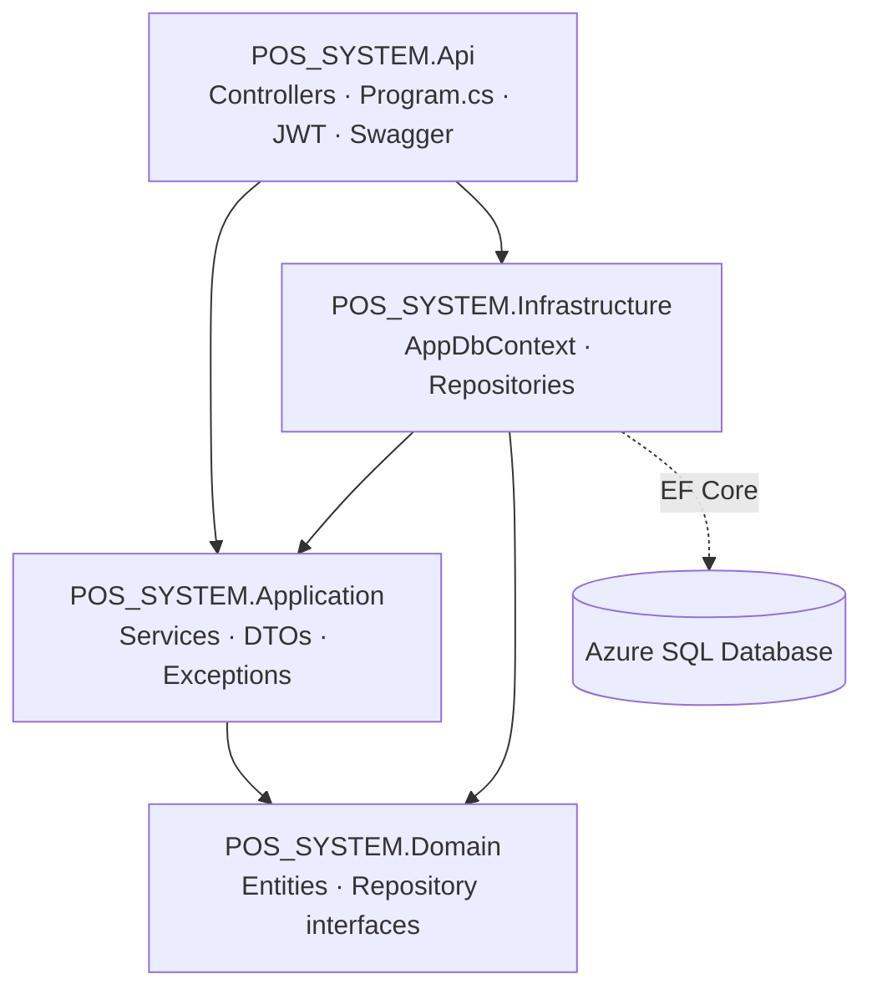
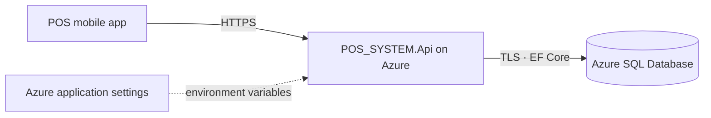

# POS_SYSTEM

A multi-company, multi-branch **Point-of-Sale backend** built with **.NET 10**, **ASP.NET Core Web API**, **Entity Framework Core** and **Microsoft SQL Server**, structured using **Clean Architecture** and the **Repository Pattern**. The production database runs on **Azure SQL Database** and the API is hosted on **Microsoft Azure**.


---

## Table of Contents

1. [Project Overview](#1-project-overview)
2. [Features](#2-features)
3. [Technology Stack](#3-technology-stack)
4. [System Architecture](#4-system-architecture)
5. [Project Structure](#5-project-structure)
6. [Database](#6-database)
7. [Azure Cloud Deployment](#7-azure-cloud-deployment)
8. [Getting Started](#8-getting-started)
9. [API Overview](#9-api-overview)
10. [Authentication](#10-authentication)
11. [Environment Configuration](#11-environment-configuration)
12. [Error Handling and Logging](#12-error-handling-and-logging)
13. [Development Guidelines](#13-development-guidelines)
14. [Known Limitations](#14-known-limitations)

---

## 1. Project Overview

`POS_SYSTEM` is the REST API behind a retail point-of-sale application. It lets a business that operates one or more **companies**, each with one or more **branches**, manage the full retail cycle:
 
- sell products at the till (completed, **held/parked** and **draft** sales),
- take returns against an existing invoice,
- buy stock from suppliers,
- track per-branch stock levels and every stock movement,
- reward customers with loyalty points,
- record expenses and close cashier shifts,
- administer users, roles and fine-grained permissions.
The solution is split into four projects that follow Clean Architecture: a dependency-free **Domain**, an **Application** layer holding business logic and DTOs, an **Infrastructure** layer holding EF Core and repository implementations, and an **Api** layer exposing HTTP endpoints.
 
> The API surface was ported from an earlier FastAPI implementation (visible in code comments). The JSON contract (property names such as `CategoryID`, the `detail` error key, snake_case route parameters) was deliberately kept compatible with the existing client — see [JSON conventions](#json-conventions).
 
---

## 2. Features

| Area | Implemented capability |
|------|------------------------|
| **Authentication** | Login with company + username/email + password, BCrypt hashing, JWT token. |
| **Users & permissions** | Users, roles, hierarchical permissions; permission keys returned at login. |
| **Companies & branches** | Multi-company, multi-branch setup; company logo upload. |
| **Catalogue** | Products (barcode, image upload, bulk price update), categories, brands, units. |
| **Sales** | Completed, **held (parked)** and **draft** sales; invoice numbers `INV-yyyyMMddNNNN`; history filters. |
| **Returns** | Look up an invoice and return items; stock is restored. |
| **Purchasing** | Purchases with items; stock increases per branch. |
| **Inventory** | Per-branch stock and a stock-movement history. |
| **Loyalty** | Earn 10 points per 1,000 paid, redeem on a sale (1 point = 1 currency unit), manual adjustment. |
| **Customers, suppliers, expenses** | CRUD with auto-generated codes; expense summary by category. |
| **Cashier shifts** | Shift summary and close with expected-vs-actual cash. |
| **API docs** | Swagger UI and OpenAPI (Development only). |

---

## 3. Technology Stack

| Category | Technology |
|----------|-----------|
| Language / Framework | C#, .NET 10 (`net10.0`), ASP.NET Core Web API |
| ORM | Entity Framework Core 10.0.11 (SQL Server provider) |
| Database | Microsoft SQL Server / Azure SQL Database |
| Cloud | Microsoft Azure |
| Authentication | `Microsoft.AspNetCore.Authentication.JwtBearer`, `System.IdentityModel.Tokens.Jwt` |
| Password hashing | `BCrypt.Net-Next` |
| API documentation | `Swashbuckle.AspNetCore` (Swagger UI), `Microsoft.AspNetCore.OpenApi` |

---

## 4. System Architecture

Dependencies point **inwards**; `Domain` references nothing.



**Request flow:** Client → Controller → Service → Repository (interface in Domain) → `AppDbContext` / EF Core → SQL Server.

Dependency injection is set up in `Program.cs` (`AddScoped` for each service and repository, `AddDbContext` with `UseSqlServer`).

---

## 5. Project Structure

`bin/` and `obj/` are omitted.
 
```text
POS_SYSTEM/
├── POS_SYSTEM.slnx                         # Solution file (4 projects)
├── README.md
│
├── POS_SYSTEM.Api/                         # Presentation layer (ASP.NET Core Web API)
│   ├── Program.cs                          # DI registrations, JWT, EF Core, middleware pipeline
│   ├── appsettings.json                    # Base configuration (connection string key, Jwt, Logging)
│   ├── appsettings.Development.json        # Development logging overrides
│   ├── Controllers/                        # 20 controllers, one per feature area
│   │   ├── AuthController.cs
│   │   ├── BranchesController.cs · BrandsController.cs · CategoriesController.cs
│   │   ├── CashierShiftsController.cs · CompaniesController.cs · CustomersController.cs
│   │   ├── ExpensesController.cs · LoyaltyController.cs · PermissionsController.cs
│   │   ├── ProductsController.cs · PurchasesController.cs · RolesController.cs
│   │   ├── SaleReturnsController.cs · SalesController.cs · StockController.cs
│   │   ├── SuppliersController.cs · UnitsController.cs · UsersController.cs
│   │   └── WeatherForecastController.cs    # Default project-template sample
│   └── Serialization/
│       └── PascalCaseIdNamingPolicy.cs     # Custom JSON naming policy (…Id → …ID)
│
├── POS_SYSTEM.Application/                 # Application / business layer
│   ├── Interfaces/                         # I*Service contracts (19)
│   ├── Services/                           # *Service implementations – business rules
│   ├── DTOs/                               # Request/response records, grouped per feature
│   └── Exceptions/
│       └── AuthExceptions.cs               # Unauthorized/Forbidden/NotFound/BadRequest AppException
│
├── POS_SYSTEM.Domain/                      # Enterprise core – no dependencies
│   ├── Entities/                           # 28 entity classes mapped to SQL tables
│   └── Interfaces/                         # I*Repository contracts (19)
│
└── POS_SYSTEM.Infrastructure/              # Data-access layer
    ├── Persistence/
    │   ├── AppDbContext.cs                 # DbSets + Fluent API mapping (OnModelCreating)
    │   └── Configurations/                 # IEntityTypeConfiguration<T> classes (see Known Limitations)
    └── Repositories/                       # *Repository implementations (19)
```
 
---
## 6. Database

- **Engine:** SQL Server (Azure SQL Database in production), accessed with EF Core through `AppDbContext`.
- **Mapping:** Fluent API in `AppDbContext.OnModelCreating`.
- **Main tables:** `Companies`, `Branches`, `Users`, `Roles`, `Permissions`, `RolePermissions`, `UserPermissions`, `Products`, `Categories`, `Brands`, `Units`, `Sizes`, `ProductStock`, `StockMovements`, `Sales`, `SaleItems`, `SaleReturns`, `SaleReturnItems`, `Purchases`, `PurchaseItems`, `Customers`, `LoyaltyTransactions`, `Suppliers`, `Expenses`, `ExpenseCategories`, `CashierShifts`.
- **Key relationships:** Company → Branches → Users/Sales/Purchases/Stock; Role ↔ Permission; Product → Category/Brand/Unit; Sale → SaleItems; Customer → Sales and LoyaltyTransactions.
- **Connection string:** key `ConnectionStrings:DefaultConnection` (never commit a real value).

**Migrations:** the repository has **no EF Core `Migrations/` folder** and the app never creates or migrates the database at startup — the schema is managed on the SQL Server side. To start using migrations:

```bash
dotnet tool install --global dotnet-ef

dotnet ef migrations add InitialCreate --project POS_SYSTEM.Infrastructure --startup-project POS_SYSTEM.Api
dotnet ef database update --project POS_SYSTEM.Infrastructure --startup-project POS_SYSTEM.Api
```

> If your database already exists, create the first migration as a baseline and skip creating existing tables.

---

## 7. Azure Cloud Deployment

| Item | Status |
|------|--------|
| Database | ✅ **Azure SQL Database** (the connection string targets a `*.database.windows.net` server with `Encrypt=True`). |
| API hosting | ⚠️ Hosted on Azure, but the exact service (App Service, Container Apps, …) cannot be verified from the repository. No Dockerfile, pipeline or publish profile is included. |
| Resource names | Placeholders: `<resource-group>`, `<server-name>`, `<app-name>`. |



**Configuration on Azure:** set these as application settings (`__` replaces `:`):

| Setting | Maps to |
|---------|---------|
| `ConnectionStrings__DefaultConnection` | `ConnectionStrings:DefaultConnection` |
| `Jwt__SecretKey` | `Jwt:SecretKey` |
| `Jwt__ExpireMinutes` | `Jwt:ExpireMinutes` |
| `ASPNETCORE_ENVIRONMENT` | `Production` (Swagger is disabled) |

Also allow the API to reach the SQL server in the Azure SQL firewall/networking settings.

**Deploy a new version:**

```bash
dotnet publish POS_SYSTEM.Api/POS_SYSTEM.Api.csproj -c Release -o ./publish
```

Deploy the `publish` folder with your Azure method — Visual Studio Publish, GitHub Actions, or, if you use App Service:

```bash
cd publish && zip -r ../publish.zip . && cd ..
az webapp deploy --resource-group <resource-group> --name <app-name> --src-path publish.zip --type zip
```

Apply database changes to Azure SQL **before** deploying code that needs them (the app does not migrate at startup).

---

## 8. Getting Started

**Prerequisites:** [.NET 10 SDK](https://dotnet.microsoft.com/download/dotnet/10.0), Visual Studio 2026 or VS Code, SQL Server (Express / Docker / Azure SQL), Git.

```bash
# 1. Clone, restore, build
git clone <your-repository-url>
cd POS_SYSTEM
dotnet restore POS_SYSTEM.slnx
dotnet build POS_SYSTEM.slnx

# 2. Set secrets (don't edit committed files with real values)
cd POS_SYSTEM.Api
dotnet user-secrets init
dotnet user-secrets set "ConnectionStrings:DefaultConnection" "<your-connection-string>"
dotnet user-secrets set "Jwt:SecretKey" "<a-long-random-secret>"
cd ..
```

**3. Create the database schema** — restore your database/script, or generate it with the `dotnet ef` commands in [Database](#6-database). The code has no seed data, so create a company, branch, role and user through the API first (`POST /companies`, `/branches`, `/roles`, `/users`).

**4. Run** — there is no `launchSettings.json`, so set the environment to enable Swagger:

```bash
# macOS / Linux
ASPNETCORE_ENVIRONMENT=Development dotnet run --project POS_SYSTEM.Api
```

```powershell
# Windows PowerShell
$env:ASPNETCORE_ENVIRONMENT = "Development"
dotnet run --project POS_SYSTEM.Api
```

**5. Open Swagger UI** at `<url printed by dotnet run>/swagger` (OpenAPI JSON: `/openapi/v1.json`). Swagger is only available in Development.

---

## 9. API Overview

Interactive documentation is in Swagger UI. Routes are lowercase; all currently need no authentication (see [§10](#10-authentication)).

| Controller | Base route | Main endpoints |
|------------|-----------|----------------|
| Auth | `/auth` | `POST login`, `GET lookup-company`, `POST verify-credentials` |
| Companies | `/companies` | CRUD, `POST upload-logo` |
| Branches | `/branches` | CRUD |
| Users | `/users` | CRUD, `GET roles`, `GET permissions/tree` |
| Roles | `/roles` | CRUD |
| Permissions | `/permissions` | `GET`, `POST`, `DELETE`, `GET/POST modules` |
| Products | `/products` | CRUD, `GET by-barcode/{barcode}`, `GET next-code`, `POST bulk-price-update`, `PUT {id}/price`, `POST upload-image` |
| Categories · Brands · Units | `/categories` · `/brands` · `/units` | CRUD |
| Customers | `/customers` | CRUD, `GET next-code` |
| Suppliers | `/suppliers` | CRUD, `GET next-code` |
| Sales | `/sales` | `GET`, `POST`, `GET/DELETE {saleId}`, `GET next-invoice-no`, `GET held`, `GET held/{saleId}`, `GET drafts`, `GET drafts/{saleId}` |
| Sale returns | `/sale-returns` | `GET lookup/{invoice_no}`, `POST` |
| Purchases | `/purchases` | `GET`, `POST`, `GET/DELETE {id}`, `GET next-number` |
| Stock | `/stock` | `GET`, `GET/PUT {id}` |
| Loyalty | `/loyalty` | `GET summary`, `GET history/{customer_id}`, `POST adjust` |
| Expenses | `/expenses` | `GET`, `POST`, `DELETE {id}`, `GET summary`, `GET by-category`, `GET/POST categories` |
| Cashier shifts | `/cashier-shifts` | `GET summary`, `POST` |
| Static files | `/uploads/...` | Uploaded product images and company logos |

**JSON conventions:** property names are PascalCase and a trailing `Id` becomes `ID` (e.g. `CategoryID`), except `CustomerId` and `SupplierId`. Errors are returned as `{ "detail": "message" }`.

**Example — login**

```json
POST /auth/login
{ "CompanyID": 1, "UsernameOrEmail": "admin", "Password": "<password>" }
```

```json
{
  "access_token": "<jwt>", "token_type": "bearer",
  "UserID": 1, "FullName": "Admin User", "RoleName": "Administrator",
  "CompanyID": 1, "PrimaryBranchID": 1,
  "PermissionKeys": ["pos.new_sale", "products.list"]
}
```

**Example — create a sale**

```json
POST /sales
{
  "CompanyID": 1, "BranchID": 1, "CustomerId": 5, "UserID": 2,
  "SubTotal": 2000, "DiscountAmount": 0, "TaxAmount": 100, "GrandTotal": 2100,
  "PaymentMethod": "Cash", "ReceivedAmount": 2500, "ChangeAmount": 400,
  "Status": "Completed",
  "Items": [{ "ProductID": 1, "Qty": 2, "UnitPrice": 1000, "DiscountPercent": 0, "TaxPercent": 5, "LineTotal": 2000 }]
}
```

`Status` can be `Completed`, `Held` or `Draft`. Only completed sales reduce stock and earn/redeem loyalty points.

---

## 10. Authentication

- `POST /auth/login` checks the password with **BCrypt**, requires an active user belonging to the selected company, and returns a **JWT** (HS256, claims `sub` and `role`, default lifetime 1440 minutes).
- `AddJwtBearer` validates the signature and lifetime (issuer/audience validation is off).
- **Not enforced yet:** no controller has `[Authorize]`, so the token is not required to call any endpoint and permission keys are not checked on the server.

---

## 11. Environment Configuration

| Key | Environment variable | Required | Default |
|-----|----------------------|----------|---------|
| `ConnectionStrings:DefaultConnection` | `ConnectionStrings__DefaultConnection` | **Yes** | — |
| `Jwt:SecretKey` | `Jwt__SecretKey` | **Yes** | built-in dev fallback (always override) |
| `Jwt:ExpireMinutes` | `Jwt__ExpireMinutes` | No | `1440` |
| `Logging:LogLevel:Default` | `Logging__LogLevel__Default` | No | `Information` |
| `ASPNETCORE_ENVIRONMENT` | — | Recommended | `Development` enables Swagger |

Where to store values: **local** → `dotnet user-secrets` or environment variables; **production** → Azure application settings (optionally Key Vault references); **never** in Git, code or README.

---

## 12. Error Handling and Logging

- Services throw `UnauthorizedAppException`, `ForbiddenAppException`, `NotFoundAppException` and `BadRequestAppException`; controllers catch them and return `401`, `403`, `404` and `400` with `{ "detail": "..." }` (`sale-returns` uses `message`).
- `[ApiController]` returns `400` automatically for invalid request bodies.
- There is no global exception middleware, so unexpected errors surface as default `500` responses.
- Logging uses the default ASP.NET Core providers, configured in the `Logging` section of `appsettings.json`.

---

## 13. Development Guidelines

- **Layering:** controllers call `I*Service`; services call `I*Repository` (declared in Domain); only repositories use `AppDbContext`.
- **Naming:** `XxxController`, `IXxxService` / `XxxService`, `IXxxRepository` / `XxxRepository`, DTOs as `XxxCreateDto`, `XxxUpdateDto`, `XxxOutDto`.
- **DI:** register every service and repository pair with `AddScoped` in `Program.cs`.

**Add a new feature:**

1. **Domain:** add the entity and `IXxxRepository`.
2. **Infrastructure:** add the `DbSet` and mapping in `AppDbContext`; implement `XxxRepository`.
3. **Application:** add DTOs, `IXxxService` and `XxxService`.
4. **Api:** add `XxxController` and register the repository and service in `Program.cs`.
5. Update the SQL Server schema (migration or script).

---

## 14. Known Limitations

- No `[Authorize]` on any endpoint (see [§10](#10-authentication)).
- No EF Core migrations are checked in.
- Creating a sale, purchase or return makes several `SaveChanges` calls without a database transaction.
- Uploaded files are saved on the host's local `uploads/` folder, which may not persist on every Azure hosting option.
- `Persistence/Configurations/*` classes are not applied; the mapping inside `AppDbContext` is what EF Core uses.
- Template leftovers: `WeatherForecastController` and empty `Class1.cs` files. No test projects.
